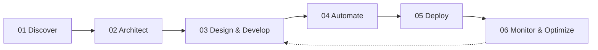

# 💫 Ravi Kumar — Full-Stack, AI & Cloud Systems Engineer

> **"From Idea to Production. I Build the Entire Product."**  
> *"I don't just build applications. I architect, develop, deploy, and manage complete production-ready products."*

---

## 👨‍💻 About Me

I am a **Full-Stack, AI & Cloud Infrastructure Engineer** with 3+ years of hands-on experience architecting, building, deploying, and operating scalable digital products and cloud-native systems. My work spans the complete engineering lifecycle — from product architecture and modern frontend applications to distributed backend microservices, intelligent AI integration, Infrastructure as Code, and production observability.

- 🏗️ **Full-Stack SaaS**: Modern web applications with Next.js, React, TypeScript, NestJS, FastAPI, and PostgreSQL with multi-tenant data isolation.
- 🤖 **AI Engineering**: Retrieval-Augmented Generation (RAG) pipelines, enterprise LLM integration, LangChain, LangGraph, and high-dimensional vector search with Qdrant.
- ☁️ **Cloud & DevOps**: Multi-cloud infrastructure across AWS and GCP, container orchestration with Kubernetes (GKE) and Docker Swarm, and Infrastructure as Code using Terraform.
- 🚀 **GitOps & Platform Engineering**: Declarative continuous delivery with ArgoCD, automated CI/CD with GitHub Actions & Jenkins, and zero-downtime rolling deployments.
- 📈 **Observability & Reliability**: Cluster-wide telemetry with Prometheus, Grafana, Loki, Tempo, and OpenTelemetry.
- 📍 **Location**: India, and senior engineering opportunities.

---

## 💻 Technical Capabilities & Ecosystem

### 🌐 Frontend & User Interfaces

### ⚙️ Backend & API Architecture

### 🧠 AI Engineering & Vector Retrieval

### ☁️ Cloud Platforms

### 🛠️ DevOps, GitOps & Containers

### 📊 Observability & Telemetry

---

## 🌟 Featured Production Projects

### 1. [Ordara — AI-Powered Business Intelligence SaaS](https://github.com/ravimahey)
> **Category**: Full-Stack Development | AI Engineering | SaaS  
> **Technologies**: Next.js 15, NestJS, FastAPI, Python, PostgreSQL, Docker, GCP, Terraform

- Multi-tenant architecture with tenant-isolated database schemas in PostgreSQL.
- Automated accounting integration with QuickBooks Online and Xero.
- Context-aware AI commentary microservice built with Python/FastAPI for automated executive trend analysis.
- Complete Infrastructure as Code using Terraform on Google Cloud Platform.

### 2. [CogniScale — Cloud-Native AI Application Platform](https://github.com/ravimahey)
> **Category**: AI Engineering | Cloud Architecture | DevOps  
> **Technologies**: GCP, GKE, Docker, Kubernetes, ArgoCD, GitHub Actions, Terraform, Prometheus, Grafana, Redis, Qdrant

- Google Kubernetes Engine (GKE) architecture managed declaratively via ArgoCD GitOps pipelines.
- Autoscaling Celery distributed worker pools backed by Redis for asynchronous AI inference workloads.
- High-dimensional vector search indexing using Qdrant vector database.
- Comprehensive cluster-wide Prometheus metrics and Grafana SLI/SLO dashboards.

### 3. [StrataOps — Automated Microservices Infrastructure](https://github.com/ravimahey)
> **Category**: DevOps | Platform Engineering  
> **Technologies**: Docker Swarm, Jenkins, GitHub Actions, GCP Artifact Registry, Nginx

- Multi-node Docker Swarm container orchestration cluster with zero-downtime rolling service updates.
- Automated CI/CD build, testing, and container deployment workflows spanning Jenkins and GitHub Actions.
- Dynamic Nginx reverse proxy routing with automated SSL termination.
- Staging and QA environment replication matching production topologies.

### 4. [AI Document Processing Platform](https://github.com/ravimahey)
> **Category**: Full-Stack | AI Engineering  
> **Technologies**: Python, FastAPI, LLMs, Vector Databases (Qdrant), React/Next.js, Docker

- Semantic chunking and vector indexing engine handling unstructured PDFs, contracts, and financial reports.
- Retrieval-Augmented Generation (RAG) with exact coordinate-level citation verification to eliminate hallucinations.
- Responsive document workbench with side-by-side verified citation inspection.
- Containerized FastAPI asynchronous API endpoints.

---

## 🔄 End-to-End Engineering Methodology

1. **01 — Discover**: Understand business goals, user challenges, schemas, and constraints.
2. **02 — Architect**: Design system topology, multi-tenant databases, tech stack, and cloud boundaries.
3. **03 — Design & Develop**: Build responsive UI, modular backend APIs, and integrated AI reasoning workflows.
4. **04 — Automate**: Implement Terraform IaC, container builds, and declarative GitOps pipelines.
5. **05 — Deploy**: Launch workloads to production cloud infrastructure (GKE, Swarm) with zero downtime.
6. **06 — Monitor & Optimize**: Continuous telemetry with Prometheus/Grafana, proactive alerting, and performance tuning.

 
